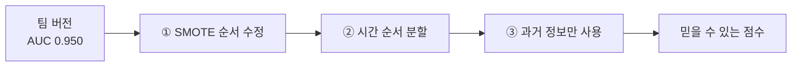
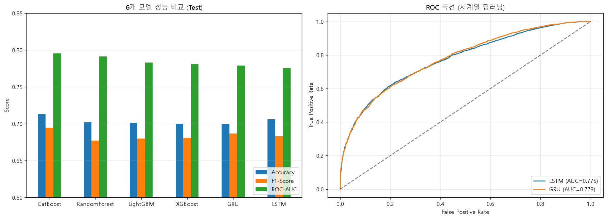

# 서울시 매장 폐업 위험 예측

서울시 상권 데이터로 **자치구·업종별 다음 분기 폐업 위험**을 예측하는 프로젝트입니다.

- **기간**: 2025.09.30 ~ 2025.10.15 (팀 프로젝트) → 이후 개인 복기·업그레이드
- **형태**: SK Networks 부트캠프 2차 프로젝트 (5인)
- **원본 팀 레포**: [SKNetworks-AI19-250818/SKN19_2nd_1team](https://github.com/SKNetworks-AI19-250818/SKN19_2nd_1team)

<!--
[TODO] 최상단 데모 자리
 - Streamlit 대시보드의 예측 결과 화면 캡처
 - 예: 
-->

---

## 한눈에 보기

| 항목 | 내용 |
|------|------|
| 무엇을 | 폐업 위험이 높은 자치구·업종을 미리 가려내기 (위험 / 정상) |
| 데이터 | 서울시 열린데이터광장 상권 데이터 8종, 약 4만 건 · 137개 항목 (2019년 1분기 ~ 2025년 2분기) |
| 흐름 | 데이터 병합 → 전처리 → 모델 비교 → CatBoost 최종 모델 → 대시보드 |
| 최종 성능 | CatBoost 정확도 0.713 / F1 0.694 / ROC-AUC 0.796 |
| 내 역할 | 데이터 전처리, CatBoost 학습 (팀) / 평가 방식 재설계, 시계열 모델(LSTM·GRU) 추가 (개인) |

---

## 내가 한 일

| 구분 | 담당 | 한 줄 요약 |
|------|------|-----------|
| 팀 | 데이터 전처리 | 상권 데이터 8종을 자치구·업종·분기 기준으로 합치고, 모델에 넣을 수 있게 정리 |
| 팀 | CatBoost 학습 | CatBoost 모델 학습과 튜닝, 팀 모델 중 최고 성능 |
| 개인 | 평가 방식 재설계 | 점수가 부풀려진 원인(데이터 누수)을 찾고, 과거 정보만 쓰는 시간 순서 평가로 다시 만듦 |
| 개인 | 시계열 모델 추가 | 분기 흐름을 순서대로 읽는 LSTM·GRU를 학습해 CatBoost와 비교 |

---

## 1. 데이터 전처리

### 무엇을 합쳤나

서로 다른 공공데이터 8종을 **자치구 × 업종 × 분기** 단위로 하나로 합쳤습니다.

| 데이터 | 담긴 내용 |
|--------|-----------|
| 점포 | 점포 수, 개업·폐업률, 프랜차이즈 수 |
| 매출 | 요일·시간대·성별·연령대별 매출 |
| 유동인구 / 상주인구 / 직장인구 | 지나다니는 사람, 사는 사람, 일하러 오는 사람 |
| 소득·소비 | 월평균 소득, 항목별 지출 |
| 임대료 | 자치구별 임대료 |
| 상권변화 | 상권이 뜨는지 지는지 보여주는 지표 |

→ 결과: **39,975행 × 137개 항목** (25개 자치구 × 63개 업종 × 26개 분기)

### 어떻게 정리했나

- 업종이 있는 데이터(점포·매출)와 자치구 단위 데이터를 따로 합친 뒤 연결
- 분기 표기가 다른 데이터(`2019년 1분기` → `20191`)를 맞추고, 중복 항목 정리
- 폐업률을 **위험 / 정상**으로 나눠 맞힐 값(정답)을 만듦
- 처음엔 폐업률 숫자를 직접 맞히는 회귀를 시도했지만 **R² 약 0.25**로 설명력이 낮아 분류로 바꿨습니다.

---

## 2. CatBoost 학습

- RandomForest, XGBoost, LightGBM, CatBoost를 같은 데이터로 비교했고, **CatBoost가 세 지표 모두 1위**였습니다.
- 자치구·업종 같은 분류형 값을 그대로 다룰 수 있어 이 데이터에 잘 맞았습니다.
- Optuna로 튜닝도 했지만 AUC는 0.7955 → 0.7995로 거의 그대로여서, **기본 설정 모델을 최종으로** 썼습니다.

| 모델 | 정확도 | F1 | ROC-AUC |
|------|:------:|:--:|:-------:|
| **CatBoost (최종)** | **0.713** | **0.694** | **0.796** |
| RandomForest | 0.702 | 0.677 | 0.791 |
| LightGBM | 0.701 | 0.680 | 0.783 |
| XGBoost | 0.700 | 0.681 | 0.781 |

*위험 기준: 폐업률 중앙값(2.3%) 이상 / 시간 순서로 학습 70% · 검증 10% · 시험 20%*

---

## 3. 평가 방식 재설계 (개인 업그레이드)

### 왜 다시 봤나

팀 버전 CatBoost는 정확도 88%, AUC 0.95가 나왔습니다. 그런데 숫자를 맞히는 회귀는 R² 0.25밖에 안 됐는데, 분류로 바꾸자 갑자기 95점이 나온 게 이상했습니다.
"모델이 잘하는 걸까, **시험 문제를 미리 보고 푸는 걸까**" 확인해 보니 세 군데에서 정보가 새고 있었습니다.

| 문제 | 무엇이 문제였나 | 고친 방법 |
|------|-----------------|-----------|
| ① SMOTE 순서 | 가짜 데이터를 만든 **다음에** 학습용·시험용을 나눠, 시험에도 가짜 데이터가 섞임 | 학습용 안에서만 적용 (최종 모델은 기준을 중앙값으로 바꿔 아예 불필요) |
| ② 랜덤 분할 | 미래 분기로 배우고 과거 분기를 시험하는 셈 | **시간 순서**로 나눔 (과거로 배우고 미래로 시험) |
| ③ 같은 분기 정보 | 예측 시점엔 아직 모르는 같은 분기 값을 입력으로 씀 | **과거 분기(t-1, t-2) 값만** 사용 |



### 실험으로 확인한 결과

원인마다 점수가 얼마나 부풀었는지는 짐작하지 않고, **하나씩 고쳐 가며 다시 학습**해서 확인했습니다.
조건이 다른 실험 두 개라서, **두 실험의 숫자는 서로 비교하지 않습니다.**

| 실험 | 위험 기준 | SMOTE | F1 (전 → 후) | ROC-AUC (전 → 후) |
|------|-----------|-------|:------------:|:-----------------:|
| **A. 최종 모델과 같은 조건** | 중앙값 (2.3%) | 사용 안 함 | 0.740 → **0.694** | 0.823 → **0.796** |
| B. 팀 기준 재현 | 상위 25% (3.6%) | 전: 나누기 전 / 후: 학습용에만 | 0.879 → 0.538 | 0.950 → 0.806 |

- **실험 A**의 개선 후 값은 최종 CatBoost 결과와 **소수점 4자리까지 같습니다.** (같은 시험 데이터 7,376행)
  여기서 AUC 하락은 거의 전부 **시간 순서 분할**에서 나왔습니다.
- **실험 B**는 팀 점수 0.950이 왜 나왔는지 보려고 팀 기준 그대로 한 실험입니다.
  AUC 하락 0.144 중 **약 83%가 SMOTE 순서**에서 나왔습니다. 시험용 '위험' 데이터의 약 3분의 2가 가짜였기 때문입니다.
- 처음엔 ③ 같은 분기 정보가 큰 문제라고 생각했는데, 두 실험 모두에서 AUC에 주는 영향이 가장 작았습니다.

점수는 내려갔지만, 이게 **실제로 미래를 예측할 때 기대할 수 있는 점수**입니다.
자세한 단계별 결과와 한계는 [`results/model_comparison.md`](results/model_comparison.md)에 정리했습니다.

---

## 4. 시계열 모델 추가: LSTM · GRU (개인 업그레이드)

### 왜 해봤나

트리 모델은 분기 하나를 독립된 데이터로 보고, 과거 정보는 "지난 분기 매출" 같은 값을 직접 만들어 넣습니다.
폐업은 시간이 지나며 서서히 나빠지다 일어나는 경우가 많아서, **분기 흐름을 순서대로 넣으면** 모델이 그 흐름을 직접 읽을 수 있을지 확인했습니다.

### 어떻게 했나

| 항목 | 내용 |
|------|------|
| 넣는 값 | 과거 **5개 분기**의 데이터 |
| 맞히는 값 | 다음 분기의 폐업 위험 (위험 / 정상) |
| 모델 | LSTM, GRU (같은 구조에서 순환층만 바꿔 비교) |
| 비교 조건 | CatBoost와 같은 위험 기준, 같은 시간 순서 분할 |

### 결과

| 모델 | 정확도 | F1 | ROC-AUC |
|------|:------:|:--:|:-------:|
| **CatBoost (기준)** | 0.713 | 0.694 | **0.796** |
| GRU | 0.700 | 0.687 | 0.779 |
| LSTM | 0.706 | 0.683 | 0.775 |



- LSTM·GRU 모두 학습은 잘 됐지만 **CatBoost보다 조금 낮았습니다.**
- 전체가 26분기뿐이라 시퀀스가 짧고, 분류형·숫자형 값이 섞인 표 데이터라 CatBoost에 유리했습니다. 폐업률이 분기마다 크게 변하지 않아 순서에서 얻을 정보도 적었습니다.
- 최종 모델은 CatBoost를 유지했고, **데이터에 맞는 모델을 고르는 게 중요하다**는 걸 직접 확인했습니다.
- LSTM·GRU는 시퀀스를 만들 때 각 그룹의 첫 5개 분기가 빠져서, 트리 모델과 시험 데이터 행이 완전히 같지는 않습니다.

---

## 전체 구조


---

## 배운 점

- **높은 점수는 먼저 의심해야 합니다.** 점수가 갑자기 좋아졌다면 모델이 잘한 건지, 평가가 느슨한 건지부터 확인해야 합니다.
- **데이터는 나눈 뒤에 만져야 합니다.** 데이터를 늘리거나 계산할 때는 학습용 안에서만 해야 시험이 공정해집니다.
- **시간이 있는 데이터는 시간 순서로 나눠야 합니다.** 실제 예측은 과거를 보고 미래를 맞히는 일이기 때문입니다.
- **원인은 짐작하지 말고 하나씩 바꿔 가며 확인해야 합니다.** 가장 크다고 생각한 원인이 실험해 보니 가장 작았습니다.
- **새롭고 복잡한 모델이 항상 정답은 아닙니다.** 이 데이터에서는 LSTM·GRU보다 CatBoost가 더 나았습니다.

---

## 사용 기술

| 분류 | 기술 |
|------|------|
| 데이터 처리 | Python, pandas, NumPy |
| 머신러닝 | scikit-learn, CatBoost, XGBoost, LightGBM, Optuna |
| 딥러닝 | PyTorch (LSTM · GRU), TabNet |
| 시각화 | Matplotlib, Seaborn |
| 대시보드 | Streamlit |

---

## 폴더 구조

```
data/raw/            원본 CSV 8종 (서울 열린데이터광장)
notebooks/           개인 복기 버전 분석 (00 → 06 순서로 실행)
  00_data_merge          8종 데이터 병합
  01_EDA                 데이터 살펴보기
  02_preprocessing       과거 정보만 쓰는 전처리, 시간 순서 분할
  03_regression_trial    회귀 시도 (R² 약 0.25 → 분류로 전환)
  04_model_comparison    트리 모델 비교, CatBoost 선정
  05_catboost_final      CatBoost 최종 모델 저장
  06_lstm_timeseries     시계열 모델 (LSTM · GRU)
notebooks/team_version/  팀 프로젝트 당시 노트북 정리본
results/             모델 비교표, 누수 전후 실험 결과
src/                 대시보드용 피처 생성 코드
streamlit/           대시보드 (예비 창업자 · 매장 운영자 페이지)
model/catboost/      대시보드용 최종 모델
images/              결과 그래프
```
