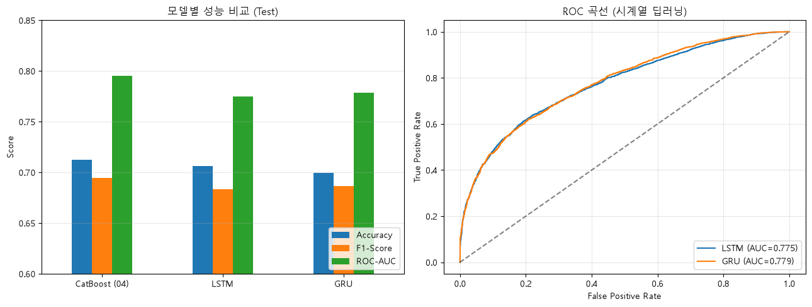

# 서울시 매장 폐업 위험 예측

서울시 상권 데이터로 **자치구·업종별 폐업 위험이 높은지 낮은지**를 예측한 프로젝트입니다.

> SKN 부트캠프 2차 팀 프로젝트(5인)로 시작했고, 이후 혼자 다시 정리하며 **평가 방식을 처음부터 다시 설계**했습니다.
> 원본 팀 레포: [SKNetworks-AI19-250818/SKN19_2nd_1team](https://github.com/SKNetworks-AI19-250818/SKN19_2nd_1team)

---

## 한눈에 보기

| 항목 | 내용 |
|------|------|
| 하려는 것 | 폐업 위험이 높은 가게를 미리 가려내기 (위험 / 정상) |
| 데이터 | 서울시 열린데이터광장 상권 데이터 8종, 약 4만 건 · 137개 항목 |
| 범위 | 25개 자치구 × 63개 업종 × 26개 분기 (2019년 1분기 ~ 2025년 2분기) |
| 최종 모델 | CatBoost |
| 가장 중요한 성과 | **점수가 높게 나온 이유를 의심하고, 평가 방식을 고쳐서 믿을 수 있는 점수로 바꾼 것** |

---

## 개선 전 · 후 한눈에 비교

| 구분 | 개선 전 (팀 버전) | 개선 후 (복기 버전) |
|------|-------------------|---------------------|
| 입력으로 쓴 정보 | 같은 분기 정보 | **과거 분기 정보만** |
| 부족한 데이터 늘리기(SMOTE) | 나누기 **전에** 적용 | **학습용 안에서만** (최종 모델은 기준을 바꿔 불필요) |
| 학습/시험 나누기 | 랜덤으로 섞어서 | **시간 순서대로** (과거로 배우고 미래로 시험) |
| 숫자 계산(스케일링 등) | - | **학습 데이터에서만** 계산 |
| 위험 기준 | 폐업률 상위 25% (3.6%) | 폐업률 중앙값 (2.3%) |

### 성능 변화 (CatBoost)

누수 전후를 비교한 실험은 **두 가지**입니다. 위험 기준과 조건이 달라서, **두 실험의 숫자는 서로 비교하지 않습니다.**

| 실험 | 위험 기준 | SMOTE | F1 (전 → 후) | ROC-AUC (전 → 후) |
|------|-----------|-------|:------------:|:-----------------:|
| **A. 최종 모델과 같은 조건** | 중앙값 (2.3%) | 사용 안 함 | 0.740 → **0.694** | 0.823 → **0.796** |
| B. 팀 기준 재현 | 상위 25% (3.6%) | 전: 나누기 전에 적용<br>후: 학습용에만 적용 | 0.879 → 0.538 | 0.950 → 0.806 |

- **실험 A**의 개선 후 값은 최종 모델(`04_model_comparison` 노트북)의 결과와 **같습니다.**
- **실험 B**는 팀 버전의 0.950이 왜 높게 나왔는지 확인하려고 팀 기준 그대로 한 실험입니다. 하락의 **약 83%가 SMOTE를 나누기 전에 적용한 것**에서 나왔습니다.
- 최종 서비스 모델의 성능은 정확도 0.713 / F1 0.694 / ROC-AUC 0.796입니다. (실험 A의 개선 후와 같음)

자세한 내용은 4번에 있습니다.

---

## 1. 문제 발견

팀 프로젝트에서 CatBoost는 정확도 88%, AUC 0.95가 나왔습니다. 그런데 다시 보니 이상했습니다.

- 폐업률은 가게마다 들쭉날쭉해서, 처음 시도한 **회귀(숫자 맞히기)는 R² 약 0.25**에 그쳤습니다. (RandomForest 0.2556)
- 숫자를 맞히기 어려웠던 문제가 **분류로 바꾸자 갑자기 95점**이 나왔습니다.
- 모델을 바꿔도, 튜닝을 해도 점수가 계속 높게만 나왔습니다.

→ "모델이 잘하는 걸까, 아니면 **시험 문제를 미리 보고 푸는 걸까**" 하는 의심이 들었습니다.

---

## 2. 누수 원인

코드를 따라가 보니, 시험 문제를 미리 보게 되는 길이 세 군데 있었습니다.

**① 가짜 데이터를 만든 뒤에 시험용을 나눴습니다.**
위험한 가게가 적어서 SMOTE(비슷한 데이터를 새로 만들어 늘리는 방법)를 썼는데, **전체 데이터를 늘린 다음에** 학습용/시험용으로 나눴습니다.
새 데이터는 주변의 진짜 데이터를 섞어 만들기 때문에, 시험용 데이터의 특징이 학습용 가짜 데이터에 **섞여 들어갑니다.**

**② 데이터를 랜덤으로 섞어서 나눴습니다.**
같은 가게의 2024년 데이터로 배우고, 2023년 데이터로 시험을 볼 수 있습니다.
즉 **미래를 보고 과거를 맞히는 셈**입니다. 같은 가게의 이웃한 분기는 서로 비슷해서 쉽게 맞힙니다.

**③ 분기가 끝나야 알 수 있는 값을 입력으로 썼습니다.**
`폐업 점포 수`처럼 정답과 직접 이어진 항목은 이미 뺐지만, 같은 분기의 매출·점포 수·개업률 같은 값은 그대로 들어가 있었습니다.
실제로 예측해야 하는 시점에는 **아직 모르는 값**입니다.

이 세 가지가 각각 점수를 얼마나 부풀렸는지는 짐작하지 않고, **4번에서 하나씩 고쳐 가며 직접 실험**해 확인했습니다.

---

## 3. 검증 방식 수정

세 가지를 각각 이렇게 고쳤습니다.

| 문제 | 고친 방법 |
|------|-----------|
| ① SMOTE를 먼저 적용 | 위험 기준을 **중앙값**으로 바꿔 위험/정상이 반반이 되게 함 → 가짜 데이터가 필요 없어짐 |
| ② 랜덤 분할 | 예측하는 분기 기준으로 **시간 순서대로** 학습 70% / 검증 10% / 시험 20% |
| ③ 같은 분기 정보 사용 | **과거 분기(t-1, t-2) 값만** 입력으로 사용, 폐업 관련 항목 제외 |

여기에 한 가지를 더 지켰습니다.

- 평균·크기 맞추기 같은 계산은 **학습 데이터에서만** 하고, 검증·시험 데이터에는 그 값을 가져다 쓰기만 합니다.

---

## 4. 재평가 결과

누수 전후 비교는 조건이 다른 실험 두 개로 나눠서 했습니다.

| 조건 | 실험 A: 최종 모델과 같은 조건 | 실험 B: 팀 기준 재현 |
|------|-------------------------------|----------------------|
| 목적 | 최종 모델 기준에서 누수 제거 효과 확인 | 팀 점수 0.950이 높게 나온 이유 확인 |
| 위험 기준 | 폐업률 **중앙값 (2.3%)** | 폐업률 **상위 25% (3.6%)** |
| 위험 비율 | 약 51% (반반) | 약 25% |
| SMOTE | **사용 안 함** | 사용 (적용 시점만 바꿈) |
| CatBoost 설정 | 04 노트북과 같은 기본 설정 (depth 6, 500회) | 팀이 찾은 설정 (depth 10, 800회) |
| 시드 | 42 (04 노트북과 같음) | 42, 7 평균 |
| 결과 파일 | `results/leakage_exp_A_median.json` | `results/leakage_exp_B_top25.json` |

### 4-1. 실험 A: 최종 모델과 같은 조건 (중앙값 기준)

최종 모델과 **위험 기준, CatBoost 설정, 시드, 시험 데이터를 모두 같게** 두고 평가 방식만 바꿨습니다.

| 단계 | 바꾼 것 | 정확도 | F1 | ROC-AUC |
|------|---------|:------:|:--:|:-------:|
| 개선 전 | 같은 분기 정보 + 랜덤 분할 | 0.742 | 0.740 | 0.823 |
| 중간 | 시간 순서 분할로 변경 | 0.717 | 0.717 | 0.796 |
| **개선 후** | + 과거 분기 정보만 사용 | **0.713** | **0.694** | **0.796** |

- **개선 후 값은 04 노트북의 최종 CatBoost 결과(0.7127 / 0.6944 / 0.7955)와 소수점 4자리까지 같습니다.** 같은 시험 데이터(7,376행)를 쓴다는 것도 확인했습니다.
- AUC 하락(0.823 → 0.796)은 거의 전부 **시간 순서 분할**에서 나왔습니다. 과거 정보만 쓰게 바꿨을 때 AUC는 거의 그대로였고, F1만 0.717 → 0.694로 내려갔습니다.
- 이 기준은 위험·정상이 반반이라 SMOTE를 쓰지 않습니다. 그래서 **SMOTE 문제는 이 실험에 들어 있지 않습니다.** 그 부분은 실험 B에서 확인했습니다.
- 개선 전은 랜덤 분할이라 시험 데이터가 다릅니다(7,995행). 개선 전 숫자는 "같은 데이터를 다르게 나눴을 때 점수가 얼마나 높아 보이는지"를 보여주는 값입니다.
- 시드를 7, 2024로 바꿔도 AUC는 개선 전 0.823~0.824, 개선 후 0.795~0.796으로 거의 같았습니다. 3개 시드 평균으로 하면 개선 후 F1은 0.696입니다.

### 4-2. 실험 B: 팀 기준 재현 (상위 25% 기준)

팀 점수 0.950이 왜 나왔는지 보려고, **위험 기준을 팀 버전과 똑같이(상위 25%) 고정**했습니다.
그리고 같은 CatBoost 모델(팀이 찾은 최적 설정)로, **평가 방식만 한 단계씩 고치며** 다시 돌렸습니다.

| 단계 | 바꾼 것 | AUC | 균형 정확도 | F1 |
|------|---------|:---:|:----------:|:--:|
| 0. 팀 방식 그대로 | - | 0.950 | 0.881 | 0.879 |
| 1. SMOTE 순서 수정 | 학습용에만 적용, 시험은 진짜 데이터만 | 0.831 | 0.720 | 0.584 |
| 2. + 시간 순서 분할 | 랜덤 → 시간 순서 | 0.814 | 0.692 | 0.547 |
| 3. + 과거 정보만 사용 | 같은 분기 정보 제거 | 0.806 | 0.687 | 0.538 |

*시드를 바꿔 2번 돌려 평균을 냈습니다. 0단계는 팀이 보고한 점수(정확도 0.880, AUC 0.950)와 거의 같게 나와서, 팀 방식을 제대로 재현했다는 걸 확인했습니다.*

**총 0.144 하락 중 어디서 얼마나 빠졌나**

| 원인 | AUC 하락 | 비중 |
|------|:--------:|:----:|
| ① SMOTE를 나누기 전에 적용 | 0.119 | **약 83%** |
| ② 랜덤 분할 | 0.017 | 약 12% |
| ③ 같은 분기 정보 사용 | 0.008 | 약 6% |

- **거품의 대부분은 ①에서 나왔습니다.** 팀 방식에서는 SMOTE로 만든 가짜 데이터가 시험용에도 섞였습니다. 계산해 보면 시험용 '위험' 데이터의 약 3분의 2가 가짜였고, 가짜 데이터는 진짜 데이터 사이를 이어서 만든 것이라 학습 데이터와 아주 비슷해서 쉽게 맞힙니다. 0.95의 대부분은 여기서 나왔습니다.
- ②는 의미 있는 크기지만 ①보다 훨씬 작았습니다.
- ③은 시드에 따른 흔들림(최대 0.005)과 비슷한 크기라서, **뚜렷한 효과라고 말하기 어렵습니다.**

**정확도 대신 AUC와 균형 정확도를 쓴 이유**
0단계 시험 데이터는 위험:정상이 반반이고, 나머지는 위험이 약 25%입니다. 비율이 달라서 정확도는 단계끼리 비교가 안 됩니다.
실제로 3단계 시험 데이터에서는 **전부 '정상'이라고만 답해도 정확도가 약 74%**라서, 정확도 0.80은 높은 점수가 아닙니다.

### 4-3. 최종 모델 비교 (위험 기준: 중앙값, 실험 A의 개선 후와 같은 조건)

같은 데이터, 같은 시간 순서 분할로 모델 5개를 공정하게 비교했습니다.

| 모델 | 정확도 | F1 | AUC |
|------|:------:|:--:|:---:|
| **CatBoost** | **0.713** | **0.694** | **0.796** |
| RandomForest | 0.702 | 0.677 | 0.791 |
| LightGBM | 0.701 | 0.680 | 0.783 |
| XGBoost | 0.700 | 0.681 | 0.781 |
| TabNet | 0.702 | 0.672 | 0.768 |

- 팀 버전에서는 모델마다 AUC가 0.83~0.95로 크게 벌어졌지만, 개선 후에는 **0.77~0.80으로 모였습니다.** 모델 차이보다 데이터가 가진 정보가 점수의 한계를 정하는 것으로 보입니다.
- Optuna로 튜닝해도 AUC가 **0.7955 → 0.7995**, 겨우 0.004 올랐습니다.
- 실험 B 결과로 보면, 팀 점수 0.95는 "모델이 그만큼 잘한다"가 아니라 **"시험에 가짜 데이터가 섞여서 부풀려진 점수"라 믿을 수 없었다**고 설명할 수 있습니다.

### 4-4. 이 실험들의 한계

**두 실험의 숫자는 서로 비교하지 않습니다.** 실험 B의 개선 후 AUC 0.806과 최종 모델의 0.796은 위험 기준과 모델 설정이 달라서 나란히 놓을 수 없습니다.

실험 A
- 시간 순서 시험은 **마지막 20% 구간 한 번**만 썼습니다. 다른 구간에서는 숫자가 달라질 수 있습니다.
- 개선 전(랜덤 분할)과 개선 후(시간 순서 분할)는 시험 데이터 행이 다릅니다.

실험 B
- **1단계에는 두 가지가 함께 바뀝니다.** 가짜 데이터가 학습에 섞이는 것과, 가짜 데이터가 시험에 섞이는 것입니다. 둘을 따로 떼어 확인하지는 않았습니다.
- 시간 순서 시험은 **마지막 5개 분기 한 구간**만 썼습니다.
- 반복 실험은 CatBoost 시드만 바꿨고, 분할과 SMOTE의 시드는 고정했습니다.

---

## 5. 배운 점

- **높은 점수는 먼저 의심해야 합니다.** 점수가 갑자기 좋아졌다면, 모델이 잘한 건지 평가가 느슨한 건지부터 확인해야 합니다.
- **데이터는 나눈 뒤에 만져야 합니다.** 데이터를 늘리거나 계산할 때는 학습용 안에서만 해야 시험이 공정해집니다. 팀 기준을 재현한 실험 B에서 점수 거품의 약 83%가 여기서 나왔습니다.
- **시간이 있는 데이터는 시간 순서로 나눠야 합니다.** 실제 서비스는 과거를 보고 미래를 맞히는 일이기 때문입니다. 최종 모델과 같은 조건인 실험 A에서는 AUC 하락(0.823 → 0.796)이 거의 전부 여기서 나왔습니다.
- **원인은 짐작하지 말고 하나씩 바꿔 가며 확인해야 합니다.** 처음엔 '같은 분기 정보를 쓰는 것'이 큰 문제라고 생각했는데, 두 실험 모두에서 AUC에 주는 영향이 가장 작았습니다.
- **실험 조건은 결과와 함께 적어야 합니다.** 위험 기준이 다른 두 실험의 숫자를 섞어 쓰면, 개선 후 점수가 최종 모델 점수와 안 맞는 것처럼 보입니다.
- **점수가 내려가도 이유를 설명할 수 있으면 더 나은 결과입니다.** 높지만 믿을 수 없는 점수보다, 낮아도 근거가 있는 점수가 쓸모 있습니다.

---

## 추가로 해본 것: 시계열 딥러닝 (LSTM / GRU)

팀 때 못 해본 것으로, 가게의 **분기별 흐름을 순서대로** 넣어 다음 분기 위험을 맞혀봤습니다. (과거 5개 분기 → 다음 분기)

| 모델 | 정확도 | F1 | AUC |
|------|:------:|:--:|:---:|
| **CatBoost (기준)** | 0.713 | 0.694 | **0.796** |
| GRU | 0.700 | 0.687 | 0.779 |
| LSTM | 0.706 | 0.683 | 0.775 |



- 학습은 잘 됐지만 **CatBoost보다 아주 조금 낮았습니다.**
- 이유는 데이터로 설명됩니다: 전체가 26분기뿐이라 짧고, 분류형·숫자형 값이 섞인 표 데이터라 CatBoost에 유리하고, 폐업률이 분기마다 크게 변하지 않아 순서를 봐도 얻을 정보가 적었습니다.
- 새롭고 복잡한 모델이 항상 정답은 아니고, **데이터에 맞는 모델을 고르는 게 중요**하다는 걸 확인했습니다.

---

## 폴더 구조

```
.
├─ data
│   └─ raw                          # 원본 CSV 8종 (서울 열린데이터광장)
├─ notebooks
│   ├─ 00_data_merge.ipynb          # 8종 데이터 병합
│   ├─ 01_EDA.ipynb                 # 데이터 살펴보기
│   ├─ 02_preprocessing.ipynb       # 과거 정보만 쓰는 전처리, 시간순 분할
│   ├─ 03_regression_trial.ipynb    # 회귀 시도 (R² 약 0.25 → 분류로 전환)
│   ├─ 04_model_comparison.ipynb    # 모델 5종 비교
│   ├─ 05_catboost_final.ipynb      # CatBoost + Optuna 최종 모델
│   └─ 06_lstm_timeseries.ipynb     # 시계열 딥러닝 (LSTM / GRU)
├─ images
└─ requirements.txt
```

노트북은 **00 → 06 순서**로 실행합니다.

## 사용 기술

Python, pandas, scikit-learn, CatBoost, XGBoost, LightGBM, PyTorch(LSTM·GRU), TabNet, Optuna
